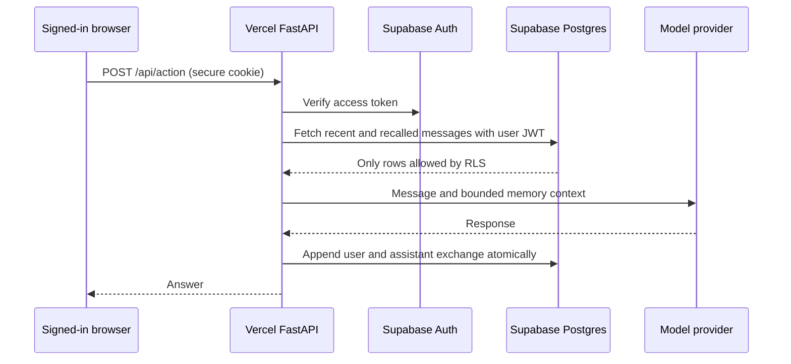

# Architecture

## Goal

Store conversations across sessions, recall earlier messages, and compress oversized context. The local product uses SQLite and vector similarity; the hosted product uses Supabase Postgres full-text recall with authenticated ownership.

## Request path

Session messages -> SQLite table and vector index -> recent window plus cross-session cosine search -> optional compression -> model -> durable reply.

Hosted: browser -> FastAPI on Vercel -> Supabase Auth token verification -> owner-scoped Postgres RPCs -> recent messages plus full-text recall -> Groq-compatible model -> atomic user/assistant exchange.

## Components

- `src/persistent_conversation_agent/engine.py`: policy and state transitions for this project.
- `src/persistent_conversation_agent/llm.py`: injected model protocol and HTTPS OpenAI-compatible adapter with timeouts and retry for transient transport failures.
- `app.py`: hosted authentication, session cookies, origin checks, request limits, and browser interface.
- `src/persistent_conversation_agent/hosted.py`: hosted memory actions and Supabase RPC calls.
- `agent-suite-platform/supabase/migrations`: shared database schema, ownership policies, quotas, and RPC grants.
- `tests/test_engine.py`: deterministic behavior and failure tests.
- `.github/workflows/ci.yml`: install and test gate.

## State and failure behavior

The bundled hashing embedder is a lexical baseline; inject a semantic embedder for production recall. Every query is scoped to a required tenant ID. The integrating service must authenticate the user and derive that ID from its trusted identity system. The forget operation deletes one session's messages, vectors, and summary.

The LLM adapter times out after 30 seconds and retries transient HTTP failures twice. Model output is untrusted input and is parsed or validated at the project boundary.

In the hosted path, a model failure returns an error without appending a partial exchange. Supabase Auth or Data API outages fail the request. The `conversation_append_exchange` RPC writes both turns in one transaction. Each table has RLS ownership policies, and exposed RPCs execute with the caller's privileges. The database limits each user to 10,000 messages. The hosted full-text recall is lexical and may miss synonyms; the local semantic adapter remains a separate mode.

## Operations checklist

1. Set secrets through a secret manager and rotate them regularly.
2. Put the service or integrating application behind TLS and authentication.
3. Persist and back up the tenant scoped SQLite store. Include its embedding model metadata in restore checks and deletion procedures.
4. Run `pytest -q` in CI before deployment.
5. Define workload specific evaluation cases, latency objectives, and rollback criteria before serving real users.

## Data model and isolation

SQLite stores `messages(tenant,session,role,content,created_at)`, `vectors(message_id,vector)`, and `summaries(tenant,session,through_id,content)`. The constructor requires a tenant ID. Every recent, recall, and delete query filters by that ID. The integrating service must derive it from authenticated identity rather than trusting a user supplied string.

The default hashing embedder is a dependency free lexical baseline. `OpenAIEmbedding` supplies semantic vectors through a live embeddings API. `metadata` records the embedding model ID and rejects a different model on an existing store, because incompatible vector spaces produce misleading recall. Recall computes cosine similarity over stored normalized vectors; this is a linear scan suitable for modest single node collections. Oversized context is summarized and saved as a checkpoint. `forget_session` deletes messages, vectors, and that summary.

For high volume collections, replace the scan with a vector index. For regulatory deletion, also address database backups and provider retention policy.

## Product interfaces and trust boundary

The installed console command and local browser call the same product operation in `src/*/__main__.py`; the browser does not replace the engine's validation or state transitions. `src/*/web.py` serves HTML and a JSON action endpoint with a one-megabyte request limit and a per-process CSRF token. It binds to loopback by default. A non-loopback bind requires `AGENT_WEB_TOKEN` of at least 16 characters, checked on every action request. The page never embeds the access token; an operator enters it in the browser. Treat the browser as an operator interface and place TLS plus identity-aware access control in front of any public endpoint. The non-root container is described in `DEPLOYMENT.md`.

The hosted browser uses email/password through Supabase Auth. The API sets Secure, HttpOnly, SameSite=Lax cookies. Mutating requests require a same-origin header, and `/api/action` verifies the access token before any RPC or model call. The browser cannot supply a tenant ID; RPCs derive ownership from `auth.uid()`. The service-role key is never used for user actions.
