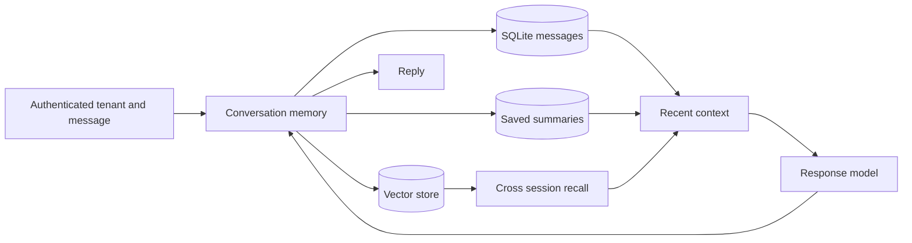

# Persistent Conversation Agent

Store conversations in SQLite, recall earlier messages by vector similarity, and compress oversized context.

## Quick start

Requires Python 3.11 or newer. From this repository:

```powershell
python -m venv .venv
.\.venv\Scripts\Activate.ps1
python -m pip install -e '.[dev]'
pytest -q
```

On macOS or Linux:

```bash
python3 -m venv .venv
source .venv/bin/activate
python -m pip install -e '.[dev]'
pytest -q
```

For live model calls, set `OPENAI_API_KEY` and optionally `OPENAI_MODEL` and `OPENAI_BASE_URL` as shown in `.env.example`. The test suite uses stubs and needs no model key.

```python
from persistent_conversation_agent.engine import ConversationMemory
from persistent_conversation_agent.llm import OpenAICompatibleLLM

memory = ConversationMemory("memory.sqlite3", OpenAICompatibleLLM.from_env(), tenant_id="user-123")
print(memory.respond("session-1", "Remember that my preferred format is bullet points."))
print(memory.respond("session-2", "What format do I prefer?"))
memory.forget_session("session-1")
```

## Architecture



| Component | Responsibility |
|---|---|
| Tenant boundary | Scopes reads and deletions by a required tenant ID. |
| Embedding adapter | Uses a local baseline or an injected semantic embedding model. |
| Context manager | Combines recent turns, vector recall, and saved compression. |

Session messages -> SQLite table and vector index -> recent window plus cross-session cosine search -> optional compression -> model -> durable reply.

See [ARCHITECTURE.md](ARCHITECTURE.md) for components, state, failure behavior, and operations.

## Deployment and safety

The bundled hashing embedder is a lexical baseline; inject a semantic embedder for production recall. Every query is scoped to a required tenant ID. The integrating service must authenticate the user and derive that ID from its trusted identity system. The forget operation deletes one session's messages, vectors, and summary.

For semantic recall, pass `embedder=OpenAIEmbedding.from_env()` from `persistent_conversation_agent.embeddings` when constructing `ConversationMemory`. Rebuild an existing vector store when changing the embedding model or dimensions. SQLite performs a linear vector scan; use a dedicated vector index for large collections.

Databases created before tenant scoping require an explicit owner mapping. The library refuses to open that legacy schema so messages cannot be silently assigned to the wrong user.

Install this as a library in an authenticated application or worker. Supply the LLM adapter through dependency injection. Keep secrets in environment variables, never in source control.

## Verification

`pytest -q` runs deterministic tests. GitHub Actions runs the same suite on pushes and pull requests.

## License

MIT. See [LICENSE](LICENSE).
