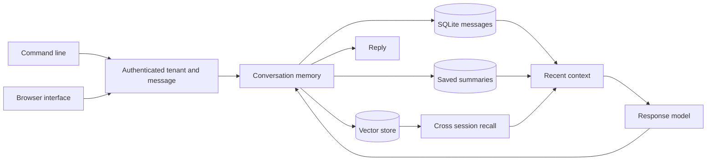
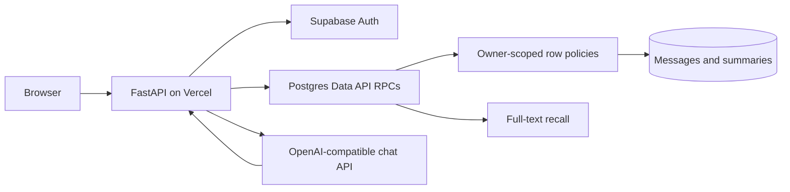

# Persistent Conversation Agent

## About

This assistant can remember what a person has said across conversations. It saves messages under a user and session, brings back relevant earlier context, and uses that context when answering a new message. A user can inspect their history, search for a memory, and forget a session.

### What you can do

- Save and review conversations by session.
- Search memories from earlier sessions before asking a new question.
- Chat with recent and recalled context, with compression when context grows too large.
- Delete a session's messages and summary when they are no longer wanted.

The CLI and local browser are usable now with SQLite. They provide a built-in lexical embedder and an optional semantic embedding mode. A hosted Vercel version has been implemented with email and password accounts, Supabase storage, and full-text recall, but its database migration and live deployment are still pending. There is no public hosted URL to use yet.

## Quick start

Requires Python 3.11 or newer. From this repository:

```powershell
python -m venv .venv
.\.venv\Scripts\Activate.ps1
python -m pip install -e '.[dev]'
pytest -q
```

On macOS or Linux:

```bash
python3 -m venv .venv
source .venv/bin/activate
python -m pip install -e '.[dev]'
pytest -q
```

For live model calls, set `OPENAI_API_KEY` and optionally `OPENAI_MODEL` and `OPENAI_BASE_URL` as shown in `.env.example`. The test suite uses stubs and needs no model key.

The installed `conversation-memory` command provides a durable product workflow. For example, `conversation-memory --db memory.sqlite3 --tenant alice add session-1 user "I prefer short answers"` stores a memory; replace `add` with `history session-1`, `recall "short answers"`, `chat session-1 "How should you respond?"`, or `forget session-1`. Only `chat` needs the model key with the default hashing embedder. Add `--semantic` before the command to use the configured OpenAI embedding model for semantic recall; select that mode when creating a new database and keep it consistent. To use the browser, run `conversation-memory --db memory.sqlite3 --tenant alice serve --port 8080` and open `http://127.0.0.1:8080`. The tenant is set by the server operator, not a browser form.

```python
from persistent_conversation_agent.engine import ConversationMemory
from persistent_conversation_agent.llm import OpenAICompatibleLLM

memory = ConversationMemory(
    "memory.sqlite3", OpenAICompatibleLLM.from_env(), tenant_id="user-123"
)
print(
    memory.respond("session-1", "Remember that my preferred format is bullet points.")
)
print(memory.respond("session-2", "What format do I prefer?"))
memory.forget_session("session-1")
```

## Architecture



Hosted path:



| Component | Responsibility |
|---|---|
| Tenant boundary | Scopes reads and deletions by a required tenant ID. |
| Embedding adapter | Uses a local baseline or an injected semantic embedding model. |
| Context manager | Combines recent turns, vector recall, and saved compression. |

Session messages -> SQLite table and vector index -> recent window plus cross-session cosine search -> optional compression -> model -> durable reply.

See [ARCHITECTURE.md](ARCHITECTURE.md) for components, state, failure behavior, and operations.

## Deployment and safety

See [DEPLOYMENT.md](DEPLOYMENT.md) for the non-root container, token-protected browser, data mounts, and release checks.

The bundled hashing embedder is a lexical baseline; inject a semantic embedder for production recall. Every query is scoped to a required tenant ID. The integrating service must authenticate the user and derive that ID from its trusted identity system. The forget operation deletes one session's messages, vectors, and summary.

For semantic recall, pass `embedder=OpenAIEmbedding.from_env()` from `persistent_conversation_agent.embeddings` when constructing `ConversationMemory`. Rebuild an existing vector store when changing the embedding model or dimensions. SQLite performs a linear vector scan; use a dedicated vector index for large collections.

Databases created before tenant scoping require an explicit owner mapping. The library refuses to open that legacy schema so messages cannot be silently assigned to the wrong user.

Install this as a library in an authenticated application or worker. Supply the LLM adapter through dependency injection. Keep secrets in environment variables, never in source control.

## Verification

`pytest -q` runs deterministic tests. GitHub Actions runs the same suite on pushes and pull requests.
`scripts/smoke_hosted.py` creates two temporary users, checks memory isolation, exercises the hosted UI API and model, and removes both users. The script requires Supabase operator credentials in the process environment and must run only from a trusted machine.

## Product guide

### Work with a memory

| Action | What it does | Model needed |
|---|---|---|
| `add` | Save a user, assistant, or summary message in a named session. | No |
| `history` | Read messages from one session. | No |
| `recall` | Find relevant messages across sessions. | No |
| `chat` | Answer using recent messages and recalled context, then save the exchange. | Yes |
| `forget` | Delete a session's messages and saved summary. | No |

A practical sequence is to save a preference in `session-1`, begin `session-2`, and ask the assistant to use that preference. `recall` lets you inspect what the system found before you rely on its next answer. `forget` is scoped to a session, so it does not silently delete unrelated conversations.

### Local and hosted data paths

The CLI and local browser keep messages, vectors, and summaries in a SQLite file chosen by the operator. Their required `--tenant` value separates users in the same database, but the application that supplies that value must first authenticate the person. The default hashing embedder is a lightweight lexical baseline. `--semantic` uses the configured embedding provider for better semantic recall, and its embedding model must remain consistent for an existing database.

The hosted implementation instead stores messages and summaries in Supabase Postgres. Supabase Auth provides email and password accounts. Each database call carries the user's access token; row-level policies scope access to that user. Hosted recall uses Postgres full-text search, so wording matters more than in the optional local semantic mode. A hosted chat app is **not yet live**: its migration must be applied and tested before deployment.

### Configuration and data care

| Setting | Applies to | Meaning |
|---|---|---|
| `OPENAI_API_KEY`, `OPENAI_BASE_URL`, `OPENAI_MODEL` | Chat | Model provider credential and endpoint. |
| `EMBEDDING_MODEL` | Local semantic mode | Embedding model tied to a local database. |
| `SUPABASE_URL`, `SUPABASE_PUBLISHABLE_KEY` | Hosted app | Account and user-scoped storage access. |
| `--db`, `--tenant` | Local CLI/browser | Database file and trusted tenant identifier. |

Memory is context for an answer, not a source of authority or a guarantee that the answer is correct. Treat recalled text as untrusted user content. Back up the local SQLite file if it matters, and include backup retention in any deletion policy. The hosted database schema places a per-user message quota at the storage boundary. See [ARCHITECTURE.md](ARCHITECTURE.md), [DEPLOYMENT.md](DEPLOYMENT.md), and [SECURITY.md](SECURITY.md) for the full trust and recovery model.

### Common issues

| Symptom | Check |
|---|---|
| A memory is not recalled | Try terms present in the saved text; hosted recall is full-text, and the local default is lexical. |
| The database rejects a changed embedding model | Rebuild local vectors before switching model or dimensions; mixed vector spaces mislead recall. |
| A conversation appears empty | Confirm the tenant and session ID. They are part of the ownership boundary. |
| Chat fails but history works | Check the model key, endpoint, and provider quota; storage actions do not require model calls. |

The forget operation removes the active session's records, but a complete privacy policy must also cover backups and the model provider's retention terms. Do not use the pending hosted URL until its migration and isolation checks have passed.

## License

MIT. See [LICENSE](LICENSE).
